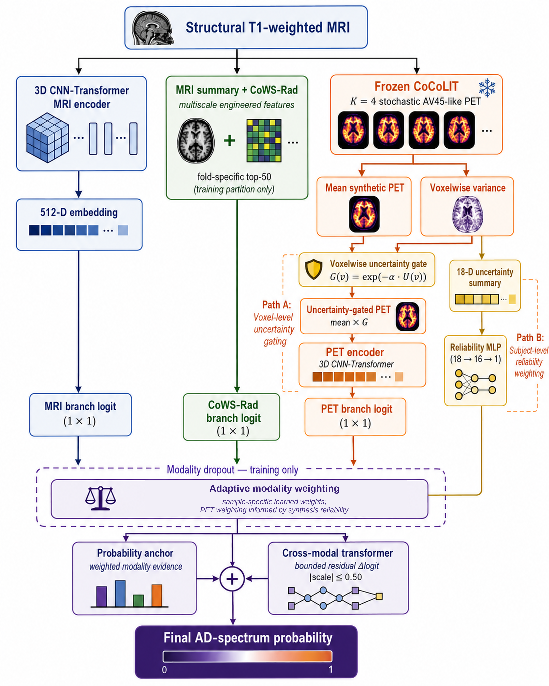

# UNICAL

[](https://doi.org/10.1007/s10278-026-02442-9)
[](https://link.springer.com/article/10.1007/s10278-026-02442-9)
[](LICENSE)

**UNICAL: Uncertainty-Aware Multimodal Learning with MRI-Derived Synthetic Amyloid PET for Alzheimer's Disease Classification** was published in the *Journal of Imaging Informatics in Medicine* in 2026.

[Read the paper](https://doi.org/10.1007/s10278-026-02442-9) · [Citation](#citation) · [Data access](#data-access) · [Reproducibility scope](#reproducibility-scope) · [License](#license)

This repository provides the UNICAL research code, public-safe configuration examples, aggregate publication artifacts, and data-access guidance accompanying the published paper.

## Motivation

Acquired amyloid PET provides molecular information but is less accessible than structural MRI. UNICAL investigates whether MRI-derived representations—including synthetic AV45-like PET—can complement structural MRI for Alzheimer’s disease-spectrum classification. Synthetic PET in this work is a computational representation derived from MRI. It is **not** measured amyloid, a clinical biomarker, or a substitute for acquired PET.

## What UNICAL does

UNICAL classifies AD-spectrum versus cognitively normal cases from three MRI-derived branches:

1. **Self-supervised structural MRI branch.** A three-dimensional CNN-transformer encoder pretrained with masked autoencoding produces a 512-dimensional MRI embedding.
2. **CoWS-Rad branch.** MRI summary descriptors and Contourlet Wavelet Stationary Radiomics features are extracted from structural MRI. Feature preprocessing and selection are fitted within each training fold.
3. **Synthetic-PET branch.** Frozen CoCoLIT inference generates `K=4` stochastic AV45-like volumes. Their voxelwise mean and population variance are used to form a confidence gate, `exp(-0.8 × normalized_variance)`, which modifies the mean synthetic PET before PET encoding.

A separate 18-dimensional PET/uncertainty summary describes foreground distributions of the mean synthetic PET, gated PET, and normalized uncertainty map, together with high- and low-uncertainty fractions and uncertainty entropy. An `18 → 16 → 1` reliability network informs subject-specific modality weighting; it does not replace the voxelwise confidence gate. The fusion model combines modality probabilities through adaptive weights, applies modality dropout during training, and adds a tanh-bounded transformer residual correction with maximum absolute scale `0.50` in logit space.



*Figure 2 from the published article, reproduced under CC BY 4.0. See [figure attribution](docs/figures/README.md).*

## Core contributions

- A self-supervised 3D MRI representation combined with explicit engineered MRI heterogeneity descriptors.
- MRI-to-AV45 synthesis with stochastic voxel-level variance and pre-encoding PET confidence gating.
- A separate subject-level reliability pathway that informs adaptive modality weighting.
- A probability anchor that retains interpretable modality-specific evidence while limiting cross-modal correction.
- Participant-grouped repeated cross-validation, component-removal analyses, stochastic-sample sensitivity, paired PET validation, and frozen cross-dataset evaluation.

## Datasets and evaluation protocol

No participant-level data are distributed by this repository.

| Role | Dataset and cohort |
| --- | --- |
| Self-supervised MRI pretraining | 1,086 OASIS-3 MRI sessions from 553 participants, disjoint from classification participants |
| OASIS-3 development | 813 MRI sessions from 811 participants: 523 cognitively normal and 290 AD-spectrum sessions |
| Paired technical PET validation | 228 QC-passed paired OASIS-3 MRI–AV45 examinations |
| Independent external evaluation | 261 matched ADNI3 participants: 87 AD and 174 cognitively normal |

Primary OASIS-3 evaluation used participant-grouped five-fold stratified cross-validation repeated over 20 prespecified seeds. External ADNI3 evaluation froze the OASIS-3-developed preprocessing, feature transformations, CoCoLIT checkpoint, encoders, fusion model, thresholds, and learned parameters; no ADNI-specific retraining, feature refitting, threshold optimization, or recalibration was performed.

The development and external endpoints are related but not identical: OASIS-3 used the paper’s AD-spectrum reference standard, whereas ADNI3 used AD-versus-cognitively-normal research-group labels.

## Published results

### OASIS-3 classification

| Metric | Value |
| --- | ---: |
| AUROC | 0.868 |
| Seed SD | 0.009 |
| Balanced accuracy | 0.814 |
| AUPRC | 0.842 |
| Sensitivity | 0.810 |
| Specificity | 0.818 |
| ECE | 0.061 |

### ADNI3 independent external evaluation

| Metric | Value |
| --- | ---: |
| AUROC | 0.836 (95% CI 0.791–0.876) |
| AUPRC | 0.802 |
| Balanced accuracy | 0.783 |
| Sensitivity | 0.782 |
| Specificity | 0.784 |
| ECE | 0.089 |

### Synthetic PET technical evaluation

The following values were calculated in 228 paired OASIS-3 MRI–AV45 examinations.

| Metric | Value |
| --- | ---: |
| MAE | 0.089 ± 0.018 |
| RMSE | 0.112 ± 0.022 |
| PSNR | 29.3 ± 2.1 dB |
| Voxelwise Pearson correlation | 0.864 ± 0.041 |
| Slice-averaged SSIM | 0.841 ± 0.035 |
| Cortical-composite SUVR Pearson correlation | 0.954 |
| Amyloid-status concordance at SUVR ≥ 1.11 | 89.9% |

These results characterize technical agreement and concordance. They do not establish biological equivalence or clinical interchangeability with acquired PET.

### Component-removal and comparator AUROC

| Configuration | AUROC |
| --- | ---: |
| Full UNICAL | 0.868 |
| Without uncertainty gate | 0.854 |
| Uniform modality weights | 0.847 |
| Without modality dropout | 0.843 |
| Without residual correction | 0.838 |
| Probability averaging | 0.826 |
| Concatenation MLP | 0.807 |

## Repository structure

The proposed public tree is derived from the current filesystem:

```text
.
├── configs/                 # Public-safe example configurations
├── data/                    # Access guidance only; restricted data are ignored
├── docs/figures/            # Attributed publication architecture diagram
├── hpc/                     # Environment helpers and portability notes
├── results/                 # Non-identifying published aggregate metrics
├── review/analysis/         # Data-independent validation-analysis entrypoints
├── scripts/                 # Preprocessing, feature, training, and analysis CLIs
├── src/                     # UNICAL models, features, SSL, training, and metrics
├── .gitattributes
├── .gitignore
├── CITATION.cff
├── LICENSE
├── THIRD_PARTY_NOTICES.md
├── citation.bib
├── requirements.txt
└── PUBLIC_RELEASE_AUDIT.md
```

Private manifests, images, checkpoints, case-level predictions, local outputs, internal drafts, site-specific Slurm submissions, and historical archives remain on the author’s machine but are excluded from the proposed public tree.

## Environment and dependencies

The published computational environment used Python 3.10.20, CUDA 12.8, and an NVIDIA H100 80 GB GPU. The repository contains an import-derived dependency inventory in `requirements.txt`, but a complete package lock for the published run was not available in the audited directory.

For a compatible Python environment:

```bash
python -m pip install -r requirements.txt
```

CoCoLIT and its checkpoint are third-party dependencies and are not redistributed here. Install and obtain them under the upstream project’s terms. GPU compatibility depends on the local CUDA driver and PyTorch build. The portable `hpc/setup_hpc.example.sh` helper is documented in `hpc/README.md` and must not be treated as an exact lock for the published environment.

During the final local repository check, 13 of 15 direct dependency imports succeeded. `SimpleITK` was not installed in the available environment, and PyTorch's CUDA libraries could not be loaded because Windows reported insufficient paging-file capacity. All documented entrypoints nevertheless completed their non-executing `--help` checks after numerical-library thread counts were limited.

## Data access

- **OASIS-3:** request access through the [official OASIS access page](https://sites.wustl.edu/oasisbrains/request-access/) and comply with the current OASIS data-use terms.
- **ADNI:** apply through the [official ADNI data page](https://adni.loni.usc.edu/data-samples/adni-data/) and comply with the ADNI Data Use Agreement and publication policy.

Repository users must create their own authorized manifests and local paths. Do not commit repository data, participant identifiers, DICOM/NIfTI files, derived synthetic PET volumes, or case-level predictions.

## Public-safe configuration

Copy the examples to ignored local configuration files and update paths for authorized inputs:

```bash
cp configs/oasis3_unical_public.example.yaml configs/oasis3_unical_local.yaml
cp configs/oasis3_pretrain_mri_encoder.example.yaml configs/oasis3_pretrain_mri_encoder_local.yaml
```

The loaders resolve relative paths from the repository root. Environment variables embedded in path strings are expanded by `src/mri_ad_cn_utils.py`.

## Available entrypoints

The following commands correspond to real CLI entrypoints. They require separately authorized data and, where applicable, third-party weights.

```bash
# MRI preprocessing and engineered features
python scripts/49_preprocess_mri_3mt_style.py --config configs/oasis3_unical_local.yaml
python scripts/43_extract_mri_summary_features.py --config configs/oasis3_unical_local.yaml
python scripts/44a_extract_cowsrad_v1_features.py --config configs/oasis3_unical_local.yaml
python scripts/44_extract_cowsrad_v2_features.py --config configs/oasis3_unical_local.yaml
python scripts/50_prepare_cowsrad_selected_features.py --config configs/oasis3_unical_local.yaml

# CoCoLIT synthesis and PET uncertainty processing
python scripts/56_generate_cocolit_pet_cache.py --config configs/oasis3_unical_local.yaml --k 4
python scripts/51_prepare_synthetic_pet_gated_features.py --config configs/oasis3_unical_local.yaml

# Self-supervised MRI encoder
python scripts/60_preprocess_pretrain_mri.py --config configs/oasis3_pretrain_mri_encoder_local.yaml --preflight
python scripts/61_pretrain_mri_encoder.py --config configs/oasis3_pretrain_mri_encoder_local.yaml
python scripts/62_validate_pretrained_encoder.py --config configs/oasis3_pretrain_mri_encoder_local.yaml

# Probability-anchored fusion and aggregate analysis
python scripts/63_train_pet_anchored_fusion.py --config configs/oasis3_unical_local.yaml --help
python scripts/64_analyze_pet_anchored_fusion.py --help
python scripts/65_aggregate_multiseed_results.py --help
python scripts/66_generate_locked_transformer_report.py --help
```

Use `--help` before running a stage. The repository does not claim one-command reproduction, and expensive training or dataset acquisition is not performed automatically.

## Reproducibility scope

Proposed public materials include core source modules, data-independent preprocessing and analysis procedures, configuration examples, seed lists, aggregate published metrics, figure-generation code, and citation metadata.

Not included:

- OASIS-3 or ADNI data and identifiers;
- participant-level manifests, predictions, or derived tables;
- synthetic PET volumes produced from restricted participant data;
- trained UNICAL checkpoints or third-party CoCoLIT weights;
- site-specific scheduler configuration and local experiment logs.

### Implementation details in this repository

- `scripts/51_prepare_synthetic_pet_gated_features.py` retains the broader 93-feature development summary. The paper's model description defines a separate 18-dimensional PET/uncertainty reliability pathway.
- `scripts/63_train_pet_anchored_fusion.py` is the retained probability-anchored fusion entrypoint and consumes the generated PET summary-feature matrix.
- The public configuration example records the publication settings `K=4`, uncertainty-gate `alpha=0.8`, and the 20 prespecified seeds. Earlier local development configurations are not part of the public tree.
- Published ADNI3 external-evaluation results are included as aggregate values. A standalone one-command ADNI3 evaluation entrypoint is not included.
- A complete package lock for the original computing environment and trained UNICAL or third-party CoCoLIT weights are not included.

## Research-use disclaimer

This software is for research use only. It has not been clinically validated for patient diagnosis, treatment selection, or clinical decision-making. MRI-derived synthetic PET is not acquired molecular imaging and must not be used as a replacement for measured amyloid PET or other indicated confirmatory biomarkers.

## Citation

Please cite the published paper. GitHub citation metadata are provided in `CITATION.cff`, and a BibTeX copy is available in `citation.bib`.

```bibtex
@article{challapalli2026unical,
  title   = {UNICAL: Uncertainty-Aware Multimodal Learning with MRI-Derived Synthetic Amyloid PET for Alzheimer's Disease Classification},
  author  = {Challapalli, Srinivasa Sai Abhijit and Bhattarai, Krishna Mani and Kamangar, Farhad A.},
  journal = {Journal of Imaging Informatics in Medicine},
  year    = {2026},
  doi     = {10.1007/s10278-026-02442-9},
  url     = {https://doi.org/10.1007/s10278-026-02442-9}
}
```

## Authors and affiliation

- Srinivasa Sai Abhijit Challapalli
- Krishna Mani Bhattarai
- Farhad A. Kamangar

Department of Computer Science and Engineering<br>
The University of Texas at Arlington<br>
Arlington, TX, USA

## License

Original repository code and documentation are released under the [MIT License](LICENSE). Third-party software, model weights, datasets, and the attributed publication figure remain subject to their own terms; see [THIRD_PARTY_NOTICES.md](THIRD_PARTY_NOTICES.md).
